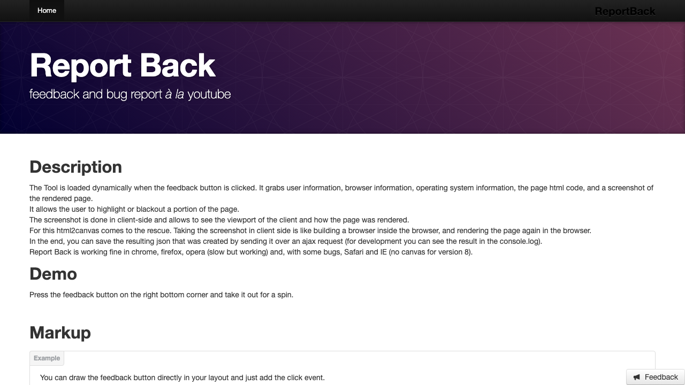
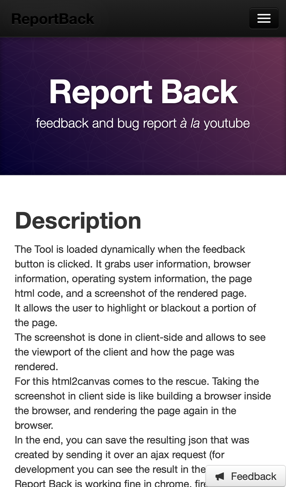
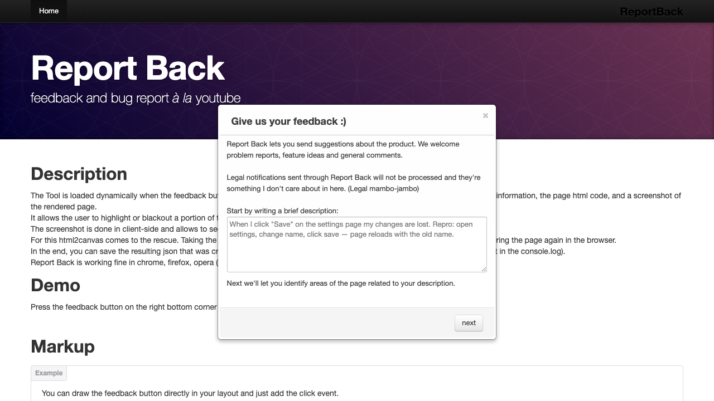
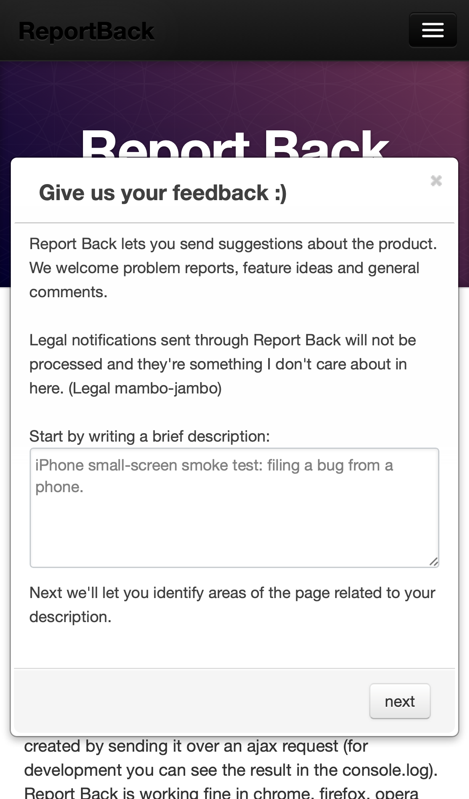
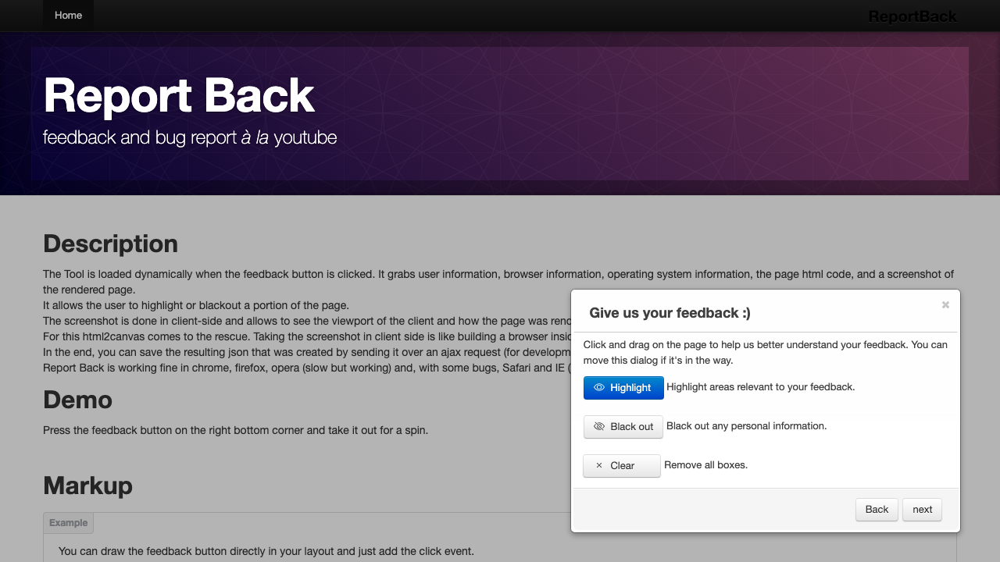
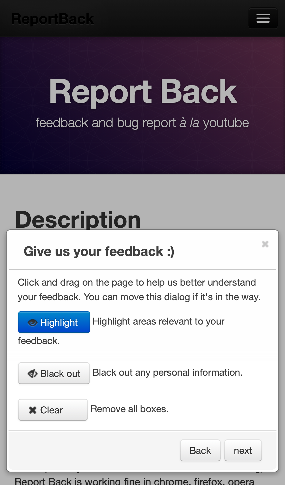
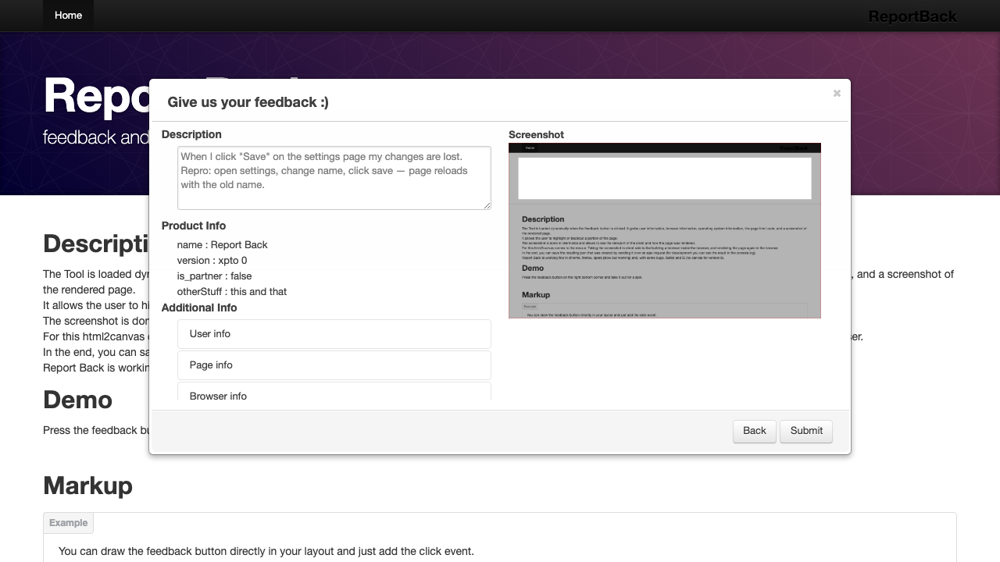
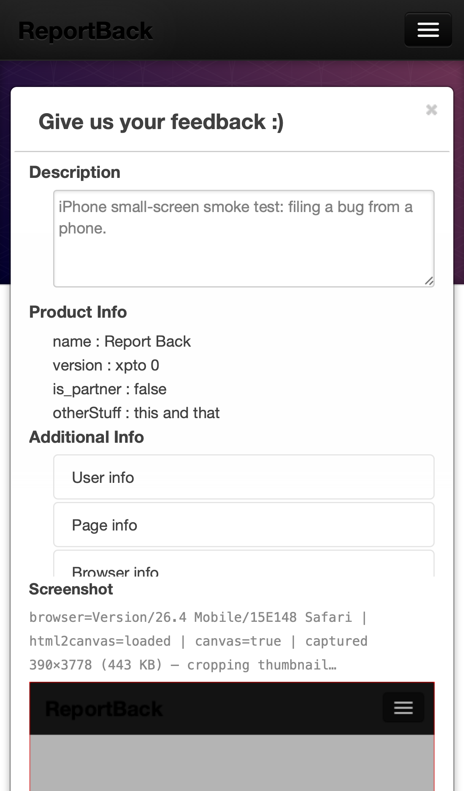
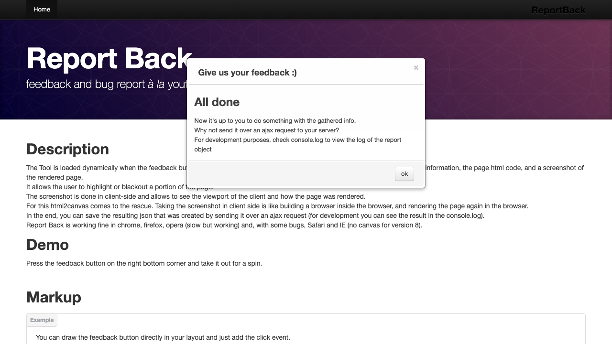
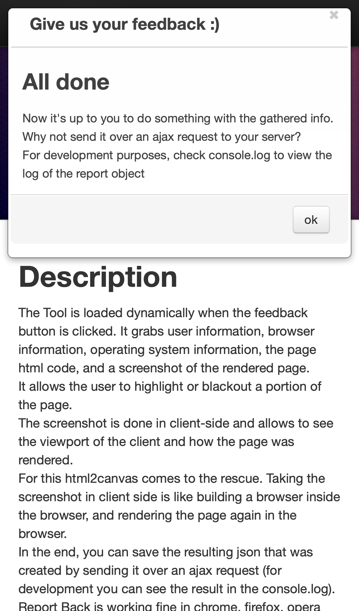

# ReportBack

Feedback and bug report *à la* YouTube — a draggable, in-page widget that
captures a screenshot, page metadata, cookies, and a user-written description.

## Demo

Try it here: **<https://filipegarcia.github.io/ReportBack/>** — press the
**Feedback** button in the bottom-right corner and take it out for a spin.

## Screenshots

| Desktop | Phone (iPhone 13) |
|---------|-------------------|
|                  |    |
|   |  |
|     |  |
|        |  |
|          |  |

## Run it locally

```bash
git clone https://github.com/filipegarcia/ReportBack.git
cd ReportBack
npm install
npm start
```

Then open <http://127.0.0.1:8080>.

## Tests & screenshots

```bash
npm run screenshots   # regenerates the PNGs above
npm run test:e2e      # full Playwright suite
```

## Author

ReportBack was created by [Filipe Garcia](mailto:hello@evolving.in).

## License

Code licensed under the [Apache License v2.0](https://www.apache.org/licenses/LICENSE-2.0).
